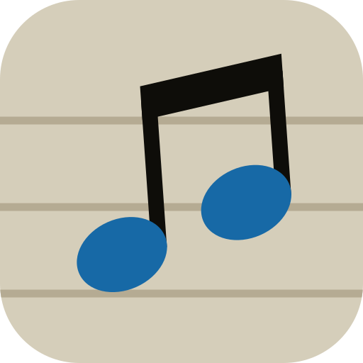

# BeBop Dots — jazz piano, step by step

A browser app (PWA) that teaches jazz piano on your MIDI keyboard. Each exercise starts with the piano alone,
one chord or note at a time, then moves through other keys, and ends with you playing along with a swinging
band (bass, drums, piano) that shows which notes you missed. Each lesson is a set of numbered exercises that
earn ★ stars, and passing an exercise unlocks the next.

## Run it

It's a static site with no build step. Host the folder anywhere (e.g. GitHub Pages) or serve it locally with
any static server, and open it in **Chrome or Edge** (Safari has no Web MIDI). It uses ES modules, so opening
`index.html` straight from disk (`file://`) won't work.

Chrome can **install it as an app** (install button in the address bar) when it runs over HTTPS or on localhost.
After the first visit it works offline, sounds included.

There's no start screen: the sounds load in the background, and your first click (e.g. **Start**) turns audio on.
Pressing **Start** asks to use your MIDI keyboard (or connect it in **Settings** ⚙); once allowed, it reconnects
automatically.
No keyboard? Click the keys of the keyboard on the screen.

## How the course works

- **Home**: 32 lessons in 7 units. Each card shows its stars.
- **Lesson** (`#/shells`): numbered exercise cards. Every part of the lesson comes as:
  1. **Piano, key of C**: the notes light up one at a time and the app waits until you play them. No clock.
  2. **Piano, other keys**: the same exercise transposed. After C come F, B♭ and E♭ (each adds one flat; they are
     the horn keys most standards and blues use), then G. Blues lessons use F, B♭, C and G; minor lessons Cm, Gm,
     Dm and Fm; the blues scale goes through all twelve keys. Songs mostly stay in their usual key.
  3. **Band**: play it in time after a count-in. 60 % passes; ★★ at 75 %, ★★★ at 90 %.
- **Exercise** (`#/shells/3`): press **Start** (or Enter, or any MIDI key). The notation shows real note values,
  bar lines, the key signature and chord symbols. The music moves from right to left under a cursor that stays in
  place: a step at a time on the piano, smoothly in time with the band. The current notes are blue, played notes
  green, and mistakes red. During **Listen first**, the keys being played light up on the keyboard.
  On band exercises, the metronome button (or `M`) turns a click on or off, also while the band plays.
  Settings choose every beat or just 2 and 4. Piano exercises have no metronome: they wait for you, with no beat.
- **Results**: stars, then **Next →**. Press Enter or any key on your piano to pick the first button, so your
  hands can stay on the keys. If a band exercise doesn't pass, you can practise just the missed spots step by
  step, try again, or try it slower.

Every screen has its own address, so the browser's Back button works and you can bookmark an exercise.

## Curriculum

| Unit | Lessons |
| --- | --- |
| 1 · Harmony basics | The five 7th chords · Dominants around the circle of 4ths |
| 2 · Left-hand voicings | Shells on ii–V–I · Guide-tone lines · Rootless voicings A/B · Minor ii–V–i |
| 3 · Lines & vocabulary | Chord scales · Arpeggios · 1–2–3–5 patterns · Enclosures · Bebop dominant scale · Blues scale (all 12 keys) |
| 4 · Rhythm, comping & bass | Swing eighths & off-beats · Comping on 2 and 4 · Charleston · Reverse Charleston · Off-beat comping · Walking bass on ii–V–I (two-feel, walking) · Walking the blues (with RH guide tones) |
| 5 · Blues, boogie & ragtime | 12-bar left-hand shuffle · Blues licks · Boogie-woogie (walking bass, octaves, riff) · Ragtime (oom-pah + syncopated tune) |
| 6 · Ideas from The Jazz Piano Book | Melodic minor harmony · Tritone substitution · So What chords · Fourth voicings · Upper-structure triads · Drop 2 voicings · Pentatonic scales |
| 7 · Songs | When the Saints Go Marching In · Riff Blues in F |

Unit 6 teaches techniques from Mark Levine's *The Jazz Piano Book* (Sher Music, 1989) with exercises and text
written for this app; it doesn't reproduce the book. The book explains each topic in far more depth.

Each song goes melody → left-hand shells → both hands, first alone and then with the band.
**About the melodies:** every song here has its real melody. Saints is public domain and Riff Blues was written
for this app. Songs still under copyright aren't included, because their melodies can't be shipped with the app.
To practise one, add it as a lesson and enter the melody from your Real Book (format below).

## Adding or editing lessons

Lessons live in `src/lessons.js`:

```js
{
  id: 'my-tune', unit: 'standards', title: 'My Tune', desc: 'One line for the card.', level: 1,
  key: 'F', keys: ['F', 'C'],                       // piano exercises in each key, then the band in `key`
  tempo: 120, style: 'swing',                       // swing | two | ballad | bossa | latin | shuffle | rag
  beatsPerBar: 4,                                   // optional; 3 for a waltz, 5 for 5/4
  rhythm: 'charleston',                             // optional comping rhythm: charleston | reverse | twoFour | offbeats
  chart: '| Gm7 C7 | Fmaj7 | ...',                  // chords in a bar share its beats; "." holds the previous one
  melody: '| A4/4 C5/8 D5/8 F5/2 | ...',            // note/length: 1 2 4 8 16, "." = dotted, r = rest
  parts: ['melody', 'shells2', 'melody+shells2'],
  about: 'What this lesson teaches', tips: ['...'],
}
```

Parts that are generated from the chords: `rootpos`, `rootposL`, `shells2`, `shells3`, `guide`, `guideLine`,
`rootless`, `twoHand`, `fourths`, `mccoy`, `soWhat`, `soWhatAmen`, `upper`, `drop2`, `arpeggio`, `scale`,
`digital`, `enclosure`, `bebop`, `pentatonic`, `shuffle`, `boogieBass`, `octaveBoogie`, `crush`, `stride`, `twoFeel`,
`walking`, plus `melody` and combinations such as `melody+shuffle` (right + left hand).
The staff of the hand that isn't playing shows rests.

Check your changes with `node tests/run.mjs`. Without Node, use
`/System/Library/Frameworks/JavaScriptCore.framework/Versions/A/Helpers/jsc -m tests/run.mjs`.
After adding files, add them to `FILES` in `sw.js` so they work offline.

## Code map

- `index.html`, `styles.css`, `manifest.webmanifest`, `sw.js` (offline cache), `icons/`, `screenshots/` (for the
  install dialog; not cached offline)
- `src/app.js`: screens (home, lesson, exercise, results), `#/` routes, input routing, settings
- `src/course.js`: the exercise sequence built from the lessons
- `src/lessons.js`: curriculum
- `src/parts.js`: voicings, lines, blues/boogie/stride figures, melodies → playable notes
- `src/theory.js`: spelled notes, intervals, chord symbols, transposition
- `src/band.js`: walking, shuffle, bossa and two-feel bass, drum grooves, piano comping, swing timing
- `src/audio.js`: Web Audio engine (sampled piano, bass and jazz drum kit, reverb, sustain pedal)
- `src/player.js`: look-ahead scheduler
- `src/scoring.js`: step-by-step sessions and play-along scoring
- `src/input.js`: Web MIDI input
- `src/ui/staff.js` (VexFlow notation) and `src/ui/keyboard.js`

## Credits

- Piano: Salamander Grand Piano by Alexander Holm (CC BY 3.0), via the Tone.js audio repository
- Bass: MusyngKite acoustic bass from gleitz/midi-js-soundfonts
- Drums: the vdrummer Jazz kit, made from AVL Drumkits *Blonde Bop* by Glen MacArthur (CC BY-SA 3.0) with a
  brushed snare from MuseScore_General (MIT); details and license notices in
  [`samples/drums/CREDITS.md`](samples/drums/CREDITS.md). The metronome is synthesized.
- Libraries: VexFlow 4.2.5 (MIT), Preact + htm (MIT / Apache-2.0)
- Fonts: Protest Strike, Darumadrop One and Archivo (Google Fonts, OFL)
